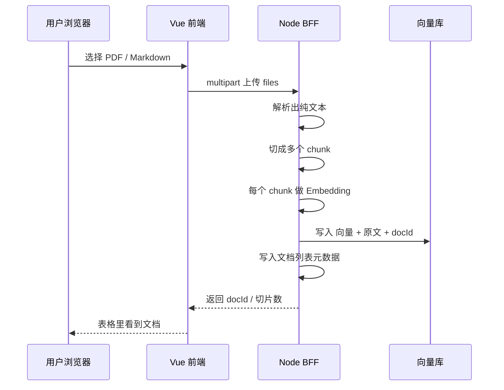
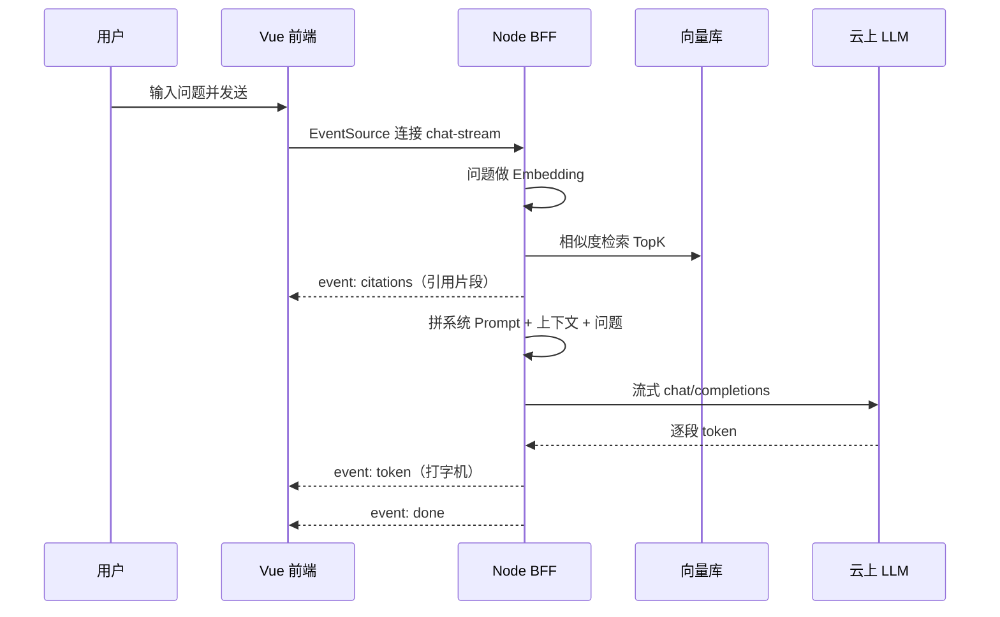

# DocChat AI 私有文档智能问答系统

面向企业 / 个人的私有文档问答 Web 应用。基于 **LLM + RAG** 把本地上传的 Markdown / PDF 建成知识库，回答严格限定在文档范围内并附带原文溯源；同时提供简易 **Agent（Function Calling）**，可自主调用自定义工具。

与通用 ChatGPT 的差异：

- 回答只使用已入库文档，没有依据时明确告知，减少幻觉
- 每条回答可展示引用片段，支持溯源
- 采用 BFF 架构：Vue3 负责交互，Node.js 承载 RAG、向量检索、LLM 调用与 Agent 编排

适合作为前端主导的 AI 应用全栈作品 / 简历项目。

---

## 系统原理详解（从零理解本项目）

如果你第一次接触 RAG / Agent，可以先把下面当成「说明书」通读一遍，再对照代码目录看。

### 1. 一句话先建立直觉

> ChatGPT 像「开卷考试靠记忆」；DocChat 像「开卷考试但只许翻你上传的那几份资料」。

通用大模型（LLM）本身**没有**你公司的 PDF、你的笔记。你直接问它「我们产品怎么重置密码」，它可能瞎编。  
本项目做法是：

1. 先把文档切成小段，变成可检索的「资料卡片」存起来  
2. 你提问时，先找出最相关的几张卡片  
3. 再把「卡片内容 + 你的问题」一起发给大模型，并命令它：**只能根据卡片回答**

这套「先检索、再生成」就叫 **RAG（Retrieval-Augmented Generation，检索增强生成）**。

另外还有 **Agent**：有些问题（现在几点、知识库有几篇文档）不在 PDF 里，而在「工具」里。大模型可以决定调用你写好的函数，再根据函数返回结果说话。

### 2. 整体架构：为什么分前端和 BFF？

```text
┌─────────────────────┐         REST / SSE          ┌──────────────────────────────┐
│  浏览器 Vue3 前端    │  ─────────────────────────► │  Node.js BFF（本仓库 server）  │
│  localhost:5173     │                              │  localhost:3000               │
│                     │ ◄──── 流式 token / 引用 ──── │                              │
│  · 上传 UI          │                              │  · 解析 PDF/MD               │
│  · 对话打字机       │                              │  · 切片 / Embedding          │
│  · 展示引用、Agent  │                              │  · 向量检索                  │
│  · 设置页           │                              │  · 拼 Prompt、调 LLM         │
└─────────────────────┘                              │  · 执行 Agent 工具           │
                                                     └──────────────┬───────────────┘
                                                                    │ HTTPS
                                                                    ▼
                                                     ┌──────────────────────────────┐
                                                     │  云上大模型 API（OpenAI 兼容） │
                                                     │  DeepSeek / 通义 / OpenAI…    │
                                                     └──────────────────────────────┘
```

| 角色 | 端口 | 干什么 | 不干什么 |
| --- | --- | --- | --- |
| **前端** | 5173 | 页面交互、上传文件、用 EventSource 收 SSE、渲染答案 | **绝不**放 API Key，不做切片/向量计算 |
| **BFF** | 3000 | 全部 AI 业务逻辑 + 调云上模型 | 不负责漂亮的 UI |

**BFF（Backend For Frontend）** 可以理解成「专门给这个前端打工的后端」：密钥、文档解析、检索都放在这里，浏览器只通过 `/api` 访问。

打开 `localhost:3000` 看到 `Cannot GET /` 是正常的——那里没有网页，只有接口；网页在 **5173**。

### 3. 三个必须懂的概念

#### 3.1 Embedding（向量化）——把文字变成坐标

计算机不擅长直接比「这句话和那段话意思像不像」，但擅长比「两个数字数组有多接近」。

- Embedding 模型把一段文字变成一串浮点数，例如长度 256 / 1536 的数组  
- **意思相近的句子，在空间里距离更近**  
- 入库时：每个文档片段算一次向量并保存  
- 提问时：问题也算一次向量，再在库里找「最近」的若干片段  

本项目默认 `USE_LOCAL_EMBEDDING=true` 用简易本地算法，方便你先跑通；正式效果应改用云上 Embedding（与入库、问答必须是**同一套**模型）。

对应代码：`server/src/lib/embeddings.ts`

#### 3.2 切片（Chunk）——为什么不整篇塞给模型？

一份 50 页手册整篇塞进 Prompt 会：

- 超出 token 上限、很贵  
- 噪声太多，模型抓不住重点  

所以入库前用 **RecursiveCharacterTextSplitter** 切成约 `CHUNK_SIZE` 字的小块，块与块之间留 `CHUNK_OVERLAP` 重叠，避免一句话被拦腰切断。

对应代码：`server/src/lib/splitter.ts`，参数在 `server/.env`

#### 3.3 向量库 ——「语义搜索引擎」

存的不是「关键词索引」，而是「片段原文 + 向量 + 元数据（文档名、docId）」。  
问答时做相似度检索，取出 **TopK** 条（默认 4 条）。

开发默认用**内存向量库**（进程重启会丢，需重新上传）；也可接 Chroma。  
对应代码：`server/src/store/vector-store.ts`  
文档列表元数据在：`server/src/store/document-store.ts`（JSON 文件）

### 4. 流程 A：文档入库（知识库是怎么建出来的）

对应页面：**知识库**；接口：`POST /api/upload`



逐步说明：

1. **上传**：前端 `FormData` 把文件交给 BFF（`multer` 先落到 `server/uploads`）  
2. **解析**：`.md` 直接读文本；`.pdf` 用 `pdf-parse` 抽文字（扫描件无文字层会失败）  
3. **切片**：长文 → 多个 chunk  
4. **向量化 + 入库**：每个 chunk 一个向量，绑上 `docId`、文件名  
5. **元数据**：列表页展示用；删除时按 `docId` 同时删向量  

对应服务：`server/src/services/ingest.service.ts`

### 5. 流程 B：RAG 问答（答案是怎么「有据可查」的）

对应页面：**对话**；接口：`GET /api/chat-stream?question=...`（SSE）



**Prompt 在干什么？**  
系统提示词写明：只能根据「参考上下文」回答；没有依据就说「未找到」；禁止编造。  
上下文就是检索到的片段，带编号 `[1][2]…`，方便模型引用、前端展示溯源。

对应代码：

- Prompt：`server/src/prompts/rag.ts`  
- 编排：`server/src/services/rag.service.ts`  
- 流式 LLM：`server/src/lib/llm.ts`  
- 前端收流：`frontend/src/api/chat.ts`、`frontend/src/views/ChatView.vue`

**SSE（Server-Sent Events）**：一种「服务器持续往浏览器推文字」的协议。  
前端用浏览器原生 `EventSource` 监听 `token` / `citations` / `agent` / `done`，所以能做出打字机效果。它只支持 **GET**，所以问题放在 query 里；**API Key 绝不能放 query**，只存在 `server/.env`。

未配置 `LLM_API_KEY` 时，BFF 会进入演示回退：把检索到的片段摘要直接返回，方便你先验证「检索是否通」。

### 6. 流程 C：Agent 工具调用（和 RAG 怎么分工）

不是所有问题都适合查文档：

| 用户问法 | 更合适的路径 |
| --- | --- |
| 「手册里怎么重置密码？」 | RAG（查文档片段） |
| 「现在几点？」 | Agent → `getCurrentTime` |
| 「知识库有几篇文档？」 | Agent → `getDocCount` |

本项目的简化链路：

1. 先让模型带着「工具说明书」（Function Schema）看问题  
2. 若模型输出「我要调某某工具 + 参数」，BFF **真正执行**对应 JS 函数  
3. 把工具结果再塞回对话，让模型用自然语言总结  
4. 若模型判断是文档问题（或工具失败），**回退到 RAG**

对应代码：

- 工具定义：`server/src/tools/`  
- Agent 编排：`server/src/services/agent.service.ts`  
- 前端展示日志：对话气泡下的 Agent 区域  

可以把它理解成：**大模型负责点菜单，真正炒菜的是你写的 Node 函数**。模型不能直接访问你的服务器时钟或文档库计数，除非你暴露工具。

### 7. 前端三页分别对应什么

| 页面 | 路由 | 原理上在干什么 |
| --- | --- | --- |
| 知识库 | `/knowledge` | 触发「入库流程」，管理文档生命周期 |
| 对话 | `/chat` | 触发「Agent + RAG」，消费 SSE，展示引用与工具日志 |
| 设置 | `/settings` | 展示服务端默认模型信息；本地保存 temperature / topK / 是否启用 Agent（**不存 Key**） |

Vite 把浏览器的 `/api/*` **代理**到 `localhost:3000`，所以前端代码里写 `/api/...` 即可，开发时无跨域问题。见 `frontend/vite.config.ts`。

### 8. 一次完整体验（对照原理走一遍）

1. 启动后打开 `http://localhost:5173`  
2. 知识库上传 `docs/sample/product-handbook.md` → 观察切片数 > 0（入库成功）  
3. 对话问：「如何重置密码？」→ 应走 RAG，下方出现引用片段  
4. 再问：「现在几点？」→ 应出现 Agent 日志与工具结果  
5. 删除该文档后再问同一业务问题 → 应答不上或提示未找到（知识库已空）

### 9. 和「直接把全文发给 ChatGPT」差在哪？

| | 全文塞进 Prompt | 本项目 RAG |
| --- | --- | --- |
| 文档变长 | 很快超限 / 很贵 | 只塞 TopK 相关片段 |
| 答案依据 | 难追溯 | 每条可展示原文引用 |
| 幻觉 | 模型容易用外部常识补全 | Prompt 约束 + 无依据则拒绝 |
| 密钥与解析 | 若放浏览器则不安全 | 全部在 BFF |

### 10. 读代码时建议的顺序

1. `server/src/index.ts` — 有哪些路由  
2. `server/src/services/ingest.service.ts` — 入库  
3. `server/src/services/rag.service.ts` — 问答主流程  
4. `server/src/services/agent.service.ts` — 工具调用  
5. `frontend/src/views/ChatView.vue` + `frontend/src/api/chat.ts` — 流式 UI  

更细的选型说明见 [docs/tech-stack.md](./docs/tech-stack.md)，踩坑见 [docs/notes.md](./docs/notes.md)。

---

## 功能概览

| 模块 | 能力 |
| --- | --- |
| 总览页 | 运行状态、学习路径、推荐提问、最近文档 |
| 知识库 | 上传 PDF/MD/TXT、搜索、批量删除、详情切片预览、下载原文件、重索引、SQLite 持久化 |
| 检索实验室 | 关键词检索 vs 对话语义 RAG 对比 |
| RAG 问答 | 向量检索 → 可自定义系统提示词 → LLM 生成；相似度阈值、上下文截断 |
| 对话 | 多会话、快捷提问、流式输出、停止生成、复制/重新生成、导出 Markdown、引用与 Agent 日志 |
| Agent | `getCurrentTime`、`getDocCount`、`listDocuments`、`searchKnowledge` |
| 设置 | 温度/TopK/阈值、Agent/多轮/改写、**系统提示词编辑**、清空知识库 |
| 主题 | 侧栏可切换 **晴空 / 夜航 / 墨蓝**，偏好本地持久化 |

## 技术栈

- **前端**：Vue 3 + TypeScript + Vite + Vue Router + Pinia + Element Plus + Axios
- **BFF**：Node.js >= 18 + Express + TypeScript（这就是后端服务）
- **数据库**：SQLite（`sql.js`，库文件 `server/data/docchat.sqlite`）
  - 表 `documents`：文档元数据 + 原文件路径
  - 表 `chunks`：文本切片 + Embedding 向量
- **文件存储**：上传原文件落盘到 `server/storage/{docId}/`
- **AI**：LangChain JS（切片等）、OpenAI 兼容 LLM / Embedding
- **解析**：`pdf-parse`、Markdown 纯文本读取

说明：前端 Vue 不是「没有后端」，`server/` 就是 Node 后端；之前缺的是**持久化数据库与原文件保存**，重启后向量/文件会丢。现已用 SQLite 落库。

不训练模型、不部署本地大模型，全部走云上 LLM API，聚焦应用层。

## 仓库结构

```text
Ai-Project/
├── docs/                 # 项目文档
├── frontend/             # Vue3 前端
├── server/               # Node BFF
├── package.json          # npm workspaces
└── .env.example
```

完整说明见 [docs/directory-structure.md](./docs/directory-structure.md)。

## 环境准备

- Node.js >= 18
- npm >= 9
- （可选）本地 [Chroma](https://www.trychroma.com/)：`chroma run --path ./chroma-data`
- 云上 LLM API Key（DeepSeek / 通义千问 / OpenAI 等，需兼容 OpenAI 协议）

## 快速启动

```bash
# 1. 安装依赖（根目录）
cd Ai-Project
npm install

# 2. 配置环境变量
cp .env.example server/.env
# 编辑 server/.env，至少填写 LLM_API_KEY / LLM_BASE_URL / LLM_MODEL

# 3. 同时启动 BFF + 前端（推荐）
npm run dev
# 或分别启动：
# npm run dev:server    # http://localhost:3000
# npm run dev:frontend  # http://localhost:5173
```

浏览器打开 **前端** `http://localhost:5173`（不要打开 3000，那是 API）：

1. **设置**：填写或确认模型参数并保存
2. **知识库**：上传 `.md` / `.pdf`
3. **对话**：提问，观察流式回答、引用片段、Agent 日志

未配置 Embedding Key 时，服务会使用本地简易向量（`USE_LOCAL_EMBEDDING=true`），便于先跑通入库与检索链路；正式效果请改用云上 Embedding。

## 核心流程

1. **入库**：上传 → 解析 → `RecursiveCharacterTextSplitter` 切片 → Embedding → 写入向量库 + 文档元数据
2. **问答**：问题 Embedding → 相似度 TopK → 约束 Prompt → SSE 流式输出答案与引用
3. **Agent**：模型判断是否调工具 → BFF 执行 → 结果回灌模型 → 最终回答

详见 [docs/tech-stack.md](./docs/tech-stack.md)。

## 接口一览

| 方法 | 路径 | 说明 |
| --- | --- | --- |
| POST | `/api/upload` | 上传文档并构建知识库 |
| GET | `/api/docs` | 文档列表 |
| DELETE | `/api/doc/:docId` | 删除文档及向量 |
| GET | `/api/stats` | 知识库统计 |
| POST | `/api/chat-stream` | SSE 流式问答（推荐，可带 history） |
| GET | `/api/chat-stream` | 兼容旧版 EventSource |
| GET | `/api/health` | 健康检查 |
| GET | `/api/settings` | 读取服务端默认配置（不含密钥） |

完整 OpenAPI 见 [docs/api.md](./docs/api.md)。

## 文档索引

| 文档 | 内容 |
| --- | --- |
| [docs/directory-structure.md](./docs/directory-structure.md) | 目录结构 |
| [docs/tech-stack.md](./docs/tech-stack.md) | 技术选型 |
| [docs/api.md](./docs/api.md) | 接口文档 |
| [docs/development-plan.md](./docs/development-plan.md) | 开发计划 |
| [docs/resume.md](./docs/resume.md) | 简历项目描述 |
| [docs/guide.md](./docs/guide.md) | 给前端看的用法和原理 |
| [docs/notes.md](./docs/notes.md) | 注意事项与踩坑 |

## 部署建议

- 前端：`npm run build --workspace=frontend`，静态资源托管（Nginx / OSS）
- BFF：`npm run build --workspace=server`，用 Node / PM2 部署，环境变量注入密钥
- 生产向量库建议替换为 PGVector 或 Milvus，不要依赖内存向量库

## 可选扩展

1. Rerank 重排，提升检索精度
2. Word / docx 解析
3. 登录与多用户知识库隔离
4. 对话记忆持久化
5. 向量库迁移到 PGVector

## License

MIT
